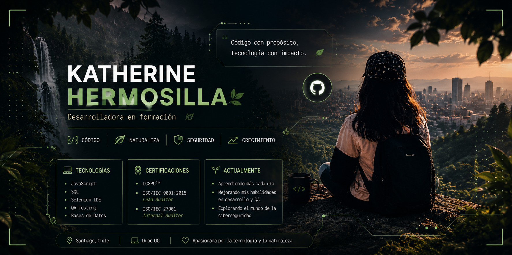

  

<h1 align="center">¡Hola! 👋 Soy Katherine Hermosilla</h1>

  

  
  
  

👩‍💻 Sobre mí
Me interesa conectar la gestión de proyectos TI, el desarrollo de software y el aseguramiento de calidad (QA) para crear soluciones útiles y bien organizadas.
- 🎓 Estudio Ingeniería en Informática en Duoc UC.
- 🧩 Durante mi práctica en TUR.COM SpA, trabajé en la gestión y optimización de información turística y desarrollé proyectos de automatización.
- 🛠️ Tengo experiencia práctica con Java, JavaScript, SQL, React, Spring Boot, Python, PostgreSQL y n8n.
- 🧪 Me interesan las pruebas manuales, la automatización de pruebas y la calidad de software.
- ☁️ Continúo aprendiendo sobre AWS y Azure.
⚡ Tecnologías y herramientas
<!-- Carrusel GIF animado: compatible con la vista de GitHub. -->

  

  

Gestión: Scrum · Kanban · Jira · Trello · Notion · Microsoft 365
QA: Testing manual · Selenium IDE · Automatización de pruebas
Automatización: n8n · Integraciones · APIs REST
Seguridad: ISO/IEC 27001 · Gestión de riesgos
🚀 Proyectos desarrollados durante mi práctica en TUR.COM
🧭 Tour Search Platform
Plataforma web para apoyar la extracción, validación, almacenamiento y consulta de información de operadores y actividades turísticas, facilitando la revisión de fichas del área de Customer Success.

Stack: Java · Spring Boot · React · Python · FastAPI · PostgreSQL · Docker
🔗 Ver repositorio
🔄 Automatización de solicitudes TO
Flujos de trabajo con n8n para apoyar el registro y seguimiento de solicitudes a operadores turísticos, integrando Slack, PostgreSQL, Google Sheets y Gmail.

Enfoque: Automatización de procesos · Trazabilidad · Integración de herramientas
🏅 Certificaciones y formación complementaria
Duoc UC
- Especialidad en Gestión de Proyectos TI.
- Especialidad en Calidad de Software.
CertiProf
- Scrum Foundation (SFPC™) · Scrum Developer (SDPC™) · DevOps Foundation (DFPC™).
- ISO/IEC 9001 Lead Auditor (I9001LA™) · ISO/IEC 27001 Internal Auditor (I27001IA™).
- Lead Cybersecurity Professional (LCSPC™) · Cyber Security Foundation (CSFPC™) · Cybersecurity Awareness (CAPC™).
Cisco Networking Academy
- JavaScript Essentials 1.

<i>«Tecnología, organización e innovación para crear mejores proyectos.»</i> 🌿

